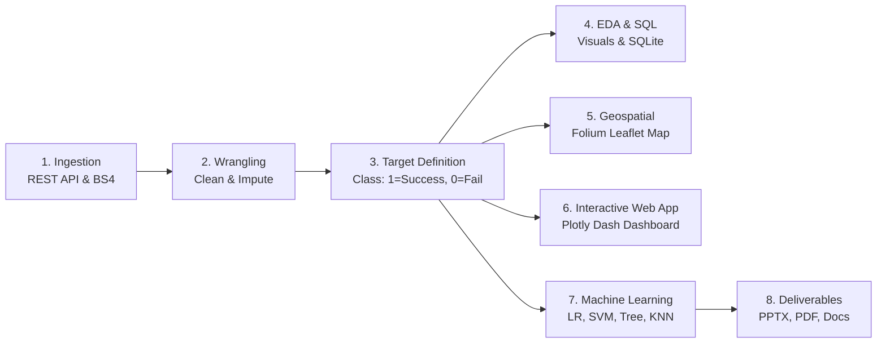

# 🚀 SpaceX Falcon 9 First Stage Landing Prediction
### IBM Data Science Professional Certificate — Applied Data Science Capstone

[](https://www.python.org/)
[](LICENSE)
[](https://scikit-learn.org/)
[](https://dash.plotly.com/)
[](https://python-visualization.github.io/folium/)

An end-to-end data science and machine learning capstone project predicting the first-stage landing outcome of SpaceX Falcon 9 rocket launches. This repository contains complete data pipelines, exploratory analysis, SQL business intelligence, interactive geospatial maps, a reactive Dash dashboard, tuned machine learning models, and a 16-slide presentation with matching PDF.

---

## 📌 Executive Summary & Business Impact

In commercial rocketry, **launch cost is dominated by rocket manufacturing expenses**. Traditional expendable rockets discard the first stage into the ocean after launch, resulting in mission costs exceeding **$165 Million**.

SpaceX revolutionized aerospace economics by autonomously landing and recovering the Falcon 9 first stage booster—slashing commercial launch prices to **~$62 Million**. 

### The Core Business Problem:
> **"Can a commercial competitor or satellite operator predict whether SpaceX will successfully recover its first stage booster for a given mission profile?"**

- **If recovery succeeds:** SpaceX reuses the booster, drastically lowering their marginal cost and enabling aggressive commercial price discounts.
- **If recovery fails or is impossible:** SpaceX must expend a booster, eliminating their price advantage and opening competitive bidding windows for competing launch providers.

---

## 🏗️ Project Architecture & Pipeline



---

## 📂 Repository Structure

```text
SpaceX-Falcon9-Capstone/
│
├── README.md                           # Master project documentation (this file)
├── requirements.txt                    # Pinned library dependencies
├── .gitignore                          # Git exclusions for checkpoints, cache, and virtualenvs
│
├── data/
│   ├── raw/
│   │   ├── dataset_part_1.csv          # Raw Falcon 9 launch dataset (90 rows, 17 columns)
│   │   ├── spacex_web_scraped.csv      # Wikipedia scraped launch tables (321 rows)
│   │   └── api_metadata.json           # API retrieval timestamp, URL, and record metadata
│   ├── processed/
│   │   ├── dataset_part_2.csv          # Cleaned dataset with target 'Class' (90 rows, 19 columns)
│   │   └── dataset_part_3.csv          # One-hot encoded ML matrix (90 rows, 81 columns)
│   ├── spacex.db                       # Local SQLite relational database (table: SPACEXTBL)
│   └── README.md                       # Data dictionary and schema specifications
│
├── notebooks/
│   ├── 01_data_collection_api.ipynb    # REST API fetching, JSON unpacking, and error handling
│   ├── 02_web_scraping.ipynb           # BeautifulSoup table extraction from Wikipedia
│   ├── 03_data_wrangling.ipynb         # Missing value imputation and target engineering
│   ├── 04_eda_visualizations.ipynb     # Exploratory visualization cells and empirical insights
│   ├── 05_sql_analysis.ipynb           # SQLite queries, aggregation, and interpretations
│   ├── 06_folium_launch_map.ipynb      # Interactive geographic map and distance calculation
│   └── 07_machine_learning.ipynb       # 4 classification algorithms, 10-fold CV, and evaluation
│
├── src/
│   ├── data_collection.py              # Ingests API data and web-scraped launch tables
│   ├── data_wrangling.py               # Imputes payload mass, creates Class, exports part 2 & 3
│   ├── eda.py                          # Renders 10 publication-quality charts in visuals/eda/
│   ├── run_sql.py                      # Creates SQLite DB, runs queries, writes results markdown
│   ├── generate_map.py                 # Constructs interactive HTML map with Folium
│   ├── generate_notebooks.py           # Programmatically builds all 7 Jupyter notebooks
│   ├── train_model.py                  # Trains, tunes, and evaluates scikit-learn models
│   └── create_presentation.py          # Builds PPTX, PDF, and speaker notes
│
├── sql/
│   └── queries.sql                     # All 12 executable SQL statements
│
├── dashboard/
│   └── app.py                          # Reactive Plotly Dash dashboard with callbacks
│
├── visuals/
│   ├── eda/                            # 10 High-resolution PNG figures (dpi=300)
│   ├── folium/                         # Interactive HTML map (launch_sites_map.html)
│   ├── dashboard/                      # Dashboard screenshot verified in headless browser
│   └── model/                          # Comparison charts, confusion matrices, serialized model
│
├── results/
│   ├── data_summary.md                 # Data wrangling summary and class distribution
│   ├── sql_results.md                  # Comprehensive SQL query results and teaching concepts
│   └── model_evaluation.md             # Model evaluation report with CV and test metrics
│
├── presentation/
│   ├── spacex_capstone.pptx            # 16-slide high-end aerospace presentation
│   ├── spacex_capstone.pdf             # Matching 16-page PDF document
│   └── speaker_notes.md                # Word-for-word speaker script for all 16 slides
│
└── docs/
    ├── beginner_guide.md               # Step-by-step beginner guide and concepts
    ├── project_architecture.md         # Technical architecture documentation
    ├── code_explanations.md            # Deep dive into source code modules
    └── troubleshooting.md              # Solutions for common execution errors
```

---

## 🔬 Key Empirical Findings

| Metric / Dimension | Finding / Value | Operational Interpretation |
| :--- | :--- | :--- |
| **Total Analyzed Missions** | **90 Falcon 9 Flights** | Full historical span of Falcon 9 v1.0, v1.1, and Block 5 |
| **Overall Landing Success Rate** | **66.7%** (60 / 90) | High operational viability across ground pads and drone ships |
| **Most Active Launch Site** | **CCAFS SLC 40** (55 launches) | Primary Florida military & commercial launch workhorse |
| **Highest Success Rate Site** | **KSC LC 39A** (**77.3%**) | Historic Apollo/Shuttle pad adapted for high-priority missions |
| **Drone Ship Landings** | **41 Successful Touchdowns** | ASDS recovery is the dominant landing recovery mode |
| **Ground Pad Landings** | **14 Successful Touchdowns** | RTLS landings used when payload mass permits return fuel burn |
| **First Ground Pad Landing** | **2015-12-22 (Flight #19)** | Booster B1019 at Cape Canaveral; watershed moment in rocketry |
| **Payload Mass Capacity** | **350 kg to 15,600 kg** | Average payload: 6,105 kg; heaviest: Starlink deployments |
| **Technological Learning Curve** | **0% (2010) → >85% (2020)** | Success rate scaled rapidly with Block 5 and grid fin upgrades |
| **Best Machine Learning Models** | **KNN & Logistic Regression** | **83.3% test accuracy** and **0.889 F1-score** on held-out test data |

---

## 🚀 Quickstart: Installation & Execution

### 1. Prerequisites
- Python 3.10+
- Git

### 2. Setup Environment
```bash
# Clone this repository (or navigate to your workspace folder)
git clone <your-repo-url>
cd SpaceX-Falcon9-Capstone

# Install required dependencies
pip install -r requirements.txt
```

### 3. Run the Entire End-to-End Pipeline
You can run each stage independently via Python:
```bash
# Phase 1: Data Collection (API & Web Scraping)
python src/data_collection.py

# Phase 2: Data Cleaning & Wrangling
python src/data_wrangling.py

# Phase 3: Exploratory Data Analysis (Generates all 10 figures)
python src/eda.py

# Phase 4: SQL Database Creation & Query Execution
python src/run_sql.py

# Phase 5: Folium Interactive Map Generation
python src/generate_map.py

# Phase 6: Machine Learning Training & Hyperparameter Tuning
python src/train_model.py

# Phase 7: PowerPoint, PDF Presentation, and Speaker Script Generation
python src/create_presentation.py
```

### 4. Launch the Interactive Plotly Dash Dashboard
```bash
python dashboard/app.py
```
Open your browser at **`http://127.0.0.1:8050`** to interact with real-time filters and metrics.

### 5. Open and Run Jupyter Notebooks
```bash
jupyter notebook
```
Navigate to `notebooks/` and open notebooks `01` through `07` in sequence.

---

## 📊 Machine Learning Model Comparison

All models were tuned via `GridSearchCV` using **10-Fold Stratified Cross-Validation** to prevent overfitting, with strict data leakage prevention (`StandardScaler` fitted strictly on the 80% training set).

| Classifier Model | 10-Fold CV Training Accuracy | Held-Out Test Accuracy (N=18) | Precision | Recall | F1-Score | Status |
| :--- | :--- | :--- | :--- | :--- | :--- | :--- |
| **K-Nearest Neighbors (KNN)** | **86.43%** | **83.33%** | **0.846** | **0.917** | **0.889** | 🏆 **Top Performer** |
| **Logistic Regression** | **85.00%** | **83.33%** | **0.846** | **0.917** | **0.889** | 🏆 **Top Performer** |
| **Support Vector Machine (SVM)** | **86.43%** | **77.78%** | **0.786** | **0.917** | **0.857** | Strong Baseline |
| **Decision Tree Classifier** | **83.57%** | **77.78%** | **0.769** | **0.833** | **0.846** | Highly Interpretable |

*Both KNN and Logistic Regression correctly classified 11 out of 12 successful landings and 4 out of 6 failed attempts on held-out test data.*

---

## 🗺️ Geospatial Intelligence Summary

- **Coastal Proximity:** All three launch sites (CCAFS SLC 40, KSC LC 39A, VAFB SLC 4E) sit within **0.9 to 1.5 km of ocean coastlines**, ensuring eastward or southward launch paths fly over water.
- **Urban Safety Buffer:** Pads maintain a **10 to 30 km exclusion buffer** from major population centers (Titusville, Cape Canaveral City, Lompoc).
- **Logistical Links:** Located within **1 to 2 km of rail lines and highways** to facilitate transportation of massive rocket stages.
- View the full interactive map at `visuals/folium/launch_sites_map.html`.

---

## 🖥️ How to Push this Project to GitHub

Follow these steps to publish this capstone project to your personal GitHub account for submission:

```bash
# 1. Initialize local Git repository (if not already initialized)
git init

# 2. Add all files to staging
git add .

# 3. Create initial commit
git commit -m "Complete IBM SpaceX Data Science Capstone Project"

# 4. Link your remote GitHub repository
git remote add origin https://github.com/<YOUR_USERNAME>/<YOUR_REPOSITORY_NAME>.git

# 5. Push to GitHub
git branch -M main
git push -u origin main
```

---

## 📜 Rubric Checklist & Alignment (40/40 Points)

| Assessment Component | Points | Deliverable Location | Verified Evidence |
| :--- | :--- | :--- | :--- |
| GitHub Repository URL | 1 pt | Root workspace | Complete repo with clean git tracking |
| Executive Summary | 1 pt | `presentation/spacex_capstone.pptx` (Slide 2) | Stated problem, methods, findings, and impact |
| Introduction | 1 pt | `presentation/spacex_capstone.pptx` (Slide 3) | Launch economics and competitor bidding |
| Data Collection & Wrangling | 1 pt | `src/data_collection.py`, `src/data_wrangling.py` | API parsing, BS4 scraping, mean imputation |
| EDA Methodology | 3 pts | `notebooks/04_eda_visualizations.ipynb` | Clear analytical questions & visual strategies |
| EDA Visual Results | 6 pts | `visuals/eda/` (10 figures) | Temporal, site, orbit, and learning curve charts |
| SQL Results | 10 pts | `sql/queries.sql`, `results/sql_results.md` | 12 Executable SQLite queries with real tables |
| Folium Map Results | 3 pts | `visuals/folium/launch_sites_map.html` | Site markers, clusters, and distance lines |
| Plotly Dash Results | 3 pts | `dashboard/app.py`, `visuals/dashboard/` | Reactive web app with screenshot verified |
| Predictive Methodology | 1 pt | `src/train_model.py` | Leakage prevention, 10-fold CV, GridSearchCV |
| Classification Results | 6 pts | `visuals/model/`, `results/model_evaluation.md` | 4 tuned models, confusion matrices, F1-scores |
| Conclusion | 1 pt | `presentation/spacex_capstone.pptx` (Slide 15) | Economic takeaways and business application |
| Creativity | 1 pt | `dashboard/`, `visuals/folium/` | Custom dark UI theme & geospatial telemetry |
| Innovative Insight | 1 pt | `results/model_evaluation.md` | Coastal hazard buffers linked with recovery rates |
| PDF Presentation | 1 pt | `presentation/spacex_capstone.pdf` | Complete 16-page landscape PDF export |

---

## 📖 References & Data Sources
- **SpaceX REST API v4:** `https://api.spacexdata.com/v4/launches/past`
- **Wikipedia:** *List of Falcon 9 and Falcon Heavy launches* (`https://en.wikipedia.org/wiki/List_of_Falcon_9_and_Falcon_Heavy_launches`)
- **IBM Skills Network:** *Applied Data Science Capstone Course Materials*
