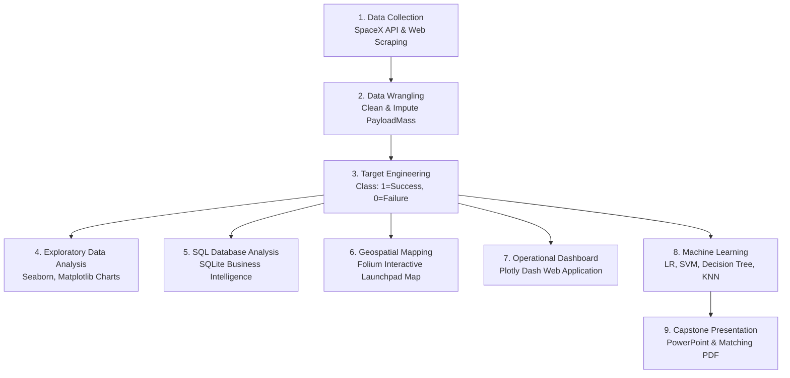

# SpaceX Falcon 9 Landing Prediction: Complete Beginner Guide

Welcome to the **SpaceX Falcon 9 First Stage Landing Prediction Capstone Project**! Whether you are completely new to Python or embarking on your first data science project, this guide will explain everything step-by-step in plain English.

---

## 1. What is Data Science?
Data science is the practice of collecting raw data from the world, cleaning and structuring it, discovering hidden patterns through exploratory analysis, and building predictive machine learning models to answer real-world business questions.

In this project, our real-world problem is:
> **"Can we predict whether a SpaceX Falcon 9 first-stage rocket booster will successfully land or crash/be lost?"**

### Why Does This Matter Economically?
- Building a Falcon 9 rocket costs around **$50 Million to $62 Million**.
- The first stage booster makes up **~70% of the vehicle cost**.
- If SpaceX can recover and reuse the first stage booster, the cost per launch plummets. SpaceX advertises Falcon 9 launches at **~$62 Million**, whereas traditional competitors (who discard the rocket into the ocean every time) charge **~$165 Million**.
- Predicting landing success helps commercial satellite clients and competitors determine bidding pricing.

---

## 2. Project Architecture & Workflow Sequence

The project is structured in 7 sequential phases:



---

## 3. How the Notebooks Depend on One Another

To ensure reproducibility, execute the notebooks in order:

| Notebook | Purpose | Key Inputs | Outputs Produced |
| :--- | :--- | :--- | :--- |
| `01_data_collection_api.ipynb` | Extracts launch data from SpaceX REST API | Public API / Backup URL | `data/raw/dataset_part_1.csv` |
| `02_web_scraping.ipynb` | Scrapes Wikipedia launch tables with BeautifulSoup | Wikipedia HTML | `data/raw/spacex_web_scraped.csv` |
| `03_data_wrangling.ipynb` | Cleans missing data, creates `Class` target | `data/raw/dataset_part_1.csv` | `data/processed/dataset_part_2.csv`<br>`data/processed/dataset_part_3.csv` |
| `04_eda_visualizations.ipynb` | Explores payload, orbits, and success trends | `dataset_part_2.csv` | High-res charts in `visuals/eda/` |
| `05_sql_analysis.ipynb` | Executes 12 operational queries in SQLite | `dataset_part_2.csv` | SQLite DB `data/spacex.db`<br>`results/sql_results.md` |
| `06_folium_launch_map.ipynb` | Maps launchpads and proximity to coastlines | `dataset_part_2.csv` | `visuals/folium/launch_sites_map.html` |
| `07_machine_learning.ipynb` | Trains & tunes 4 classifiers (LR, SVM, Tree, KNN) | `dataset_part_3.csv` | Confusion matrices & comparison charts |

---

## 4. How to Run the Project on Your Machine

### Step 1: Open Terminal / PowerShell
Open your terminal in the project directory:
```bash
cd "c:\Users\NEEL\Desktop\coursera assignment\SpaceX"
```

### Step 2: Install Required Dependencies
All required libraries are listed in `requirements.txt`:
```bash
pip install -r requirements.txt
```

### Step 3: Run the Complete Pipeline Automatically
You can execute each standalone script directly from the terminal:
```bash
# 1. Fetch raw data from API and Wikipedia
python src/data_collection.py

# 2. Clean data, impute missing values, construct Class target
python src/data_wrangling.py

# 3. Generate all 10 high-resolution EDA figures
python src/eda.py

# 4. Create SQLite database and run all business queries
python src/run_sql.py

# 5. Build the Folium interactive geographic map
python src/generate_map.py

# 6. Train, tune, and evaluate all 4 Machine Learning models
python src/train_model.py

# 7. Generate PowerPoint, PDF presentation, and speaker notes
python src/create_presentation.py
```

### Step 4: Launch the Interactive Plotly Dash Dashboard
To start the live dashboard:
```bash
python dashboard/app.py
```
Then open your web browser and navigate to:
```text
http://127.0.0.1:8050
```

### Step 5: How to Run the Jupyter Notebooks
If you prefer running interactively cell-by-cell in Jupyter:
```bash
jupyter notebook
```
In the browser window that opens, navigate to the `notebooks/` folder and open `01_data_collection_api.ipynb`. Run each cell by pressing `Shift + Enter`.

---

## 5. How to Interpret Machine Learning Metrics

When evaluating landing prediction models, avoid looking solely at accuracy. Because 66.7% of launches succeeded, a model that simply guessed "Success" every time would score 66.7% accuracy while completely failing to detect booster crashes.

Key metrics to evaluate:
- **Accuracy:** Overall percentage of correct predictions:
  $$\text{Accuracy} = \frac{\text{True Positives} + \text{True Negatives}}{\text{Total Predictions}}$$
- **Precision:** Of all launches predicted to land successfully, how many actually did?
  $$\text{Precision} = \frac{\text{True Positives}}{\text{True Positives} + \text{False Positives}}$$
- **Recall (Sensitivity):** Of all launches that actually landed successfully, how many did the model detect?
  $$\text{Recall} = \frac{\text{True Positives}}{\text{True Positives} + \text{False Negatives}}$$
- **F1-Score:** The harmonic mean of Precision and Recall:
  $$\text{F1} = 2 \times \frac{\text{Precision} \times \text{Recall}}{\text{Precision} + \text{Recall}}$$
- **Confusion Matrix:**
  - **Top-Left (TN):** Actual failures correctly predicted as failures.
  - **Top-Right (FP):** Actual failures incorrectly predicted as successes.
  - **Bottom-Left (FN):** Actual successes incorrectly predicted as failures.
  - **Bottom-Right (TP):** Actual successes correctly predicted as successes.

---

## 6. Key Empirical Findings Summary

1. **Overall Recovery Rate:** 66.7% (60 successful recoveries out of 90 historical Falcon 9 launches).
2. **Technological Learning Curve:** Landing success rose from 0% (2010–2013) to over 85% by 2018–2020.
3. **Launch Complex Performance:**
   - **Kennedy Space Center (KSC LC 39A):** Highest success rate (**77.3%**).
   - **Vandenberg (VAFB SLC 4E):** Second highest success rate (**76.9%**).
   - **Cape Canaveral (CCAFS SLC 40):** High launch volume workhorse (**60.0%** across 55 missions).
4. **Orbit Influence:** ES-L1, GEO, HEO, and SSO achieved 100% recovery. Heavy Geostationary Transfer Orbit (GTO) missions posed the greatest challenge due to hypersonic reentry velocities.
5. **Best Predictive Model:** Tuned **K-Nearest Neighbors (KNN)** and **Logistic Regression** achieved **83.3% test accuracy** and **0.889 F1-score** on held-out test data.
