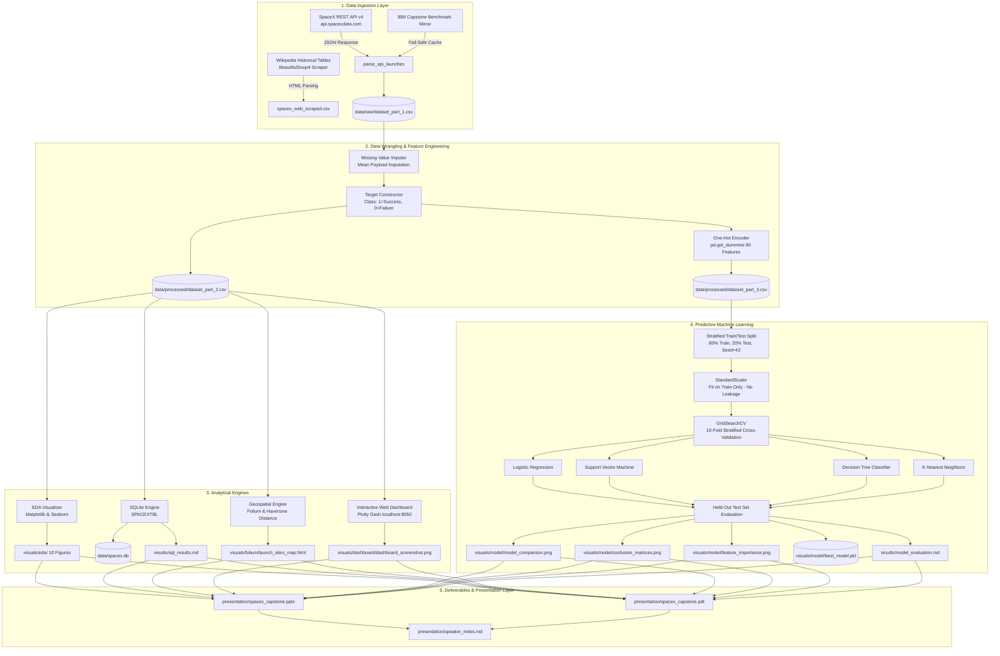

# SpaceX Falcon 9 Capstone: Project Architecture & Technical Design

This document details the software architecture, data pipelines, module interactions, and directory layout of the **SpaceX Falcon 9 First Stage Landing Prediction** system.

---

## 1. System Architecture Diagram



---

## 2. Directory Hierarchy

```text
SpaceX-Falcon9-Capstone/
│
├── README.md                           # Master GitHub documentation with badges and instructions
├── requirements.txt                    # Pinned library dependencies
├── .gitignore                          # Git exclude rules for cache, virtualenvs, and temp files
│
├── data/
│   ├── raw/
│   │   ├── dataset_part_1.csv          # Raw Falcon 9 launch dataset (90 rows, 17 columns)
│   │   ├── spacex_web_scraped.csv      # Wikipedia scraped launch records (321 rows)
│   │   └── api_metadata.json           # API retrieval timestamp, URL, and record metadata
│   ├── processed/
│   │   ├── dataset_part_2.csv          # Cleaned dataset with target 'Class' (90 rows, 19 columns)
│   │   └── dataset_part_3.csv          # One-hot encoded ML matrix (90 rows, 81 columns)
│   ├── spacex.db                       # Local SQLite relational database (table: SPACEXTBL)
│   └── README.md                       # Data dictionary and schema specifications
│
├── notebooks/
│   ├── 01_data_collection_api.ipynb    # API fetching, JSON unpacking, and error handling
│   ├── 02_web_scraping.ipynb           # BeautifulSoup table extraction from Wikipedia
│   ├── 03_data_wrangling.ipynb         # Missing value imputation and target engineering
│   ├── 04_eda_visualizations.ipynb     # Exploratory visualization cells and findings
│   ├── 05_sql_analysis.ipynb           # SQLite queries, aggregation, and interpretations
│   ├── 06_folium_launch_map.ipynb      # Interactive geographic map and distance calculation
│   └── 07_machine_learning.ipynb       # 4 classification algorithms, 10-fold CV, and evaluation
│
├── src/
│   ├── data_collection.py              # Ingests API data and web-scraped launch tables
│   ├── data_wrangling.py               # Imputes payload mass, creates Class, exports part 2 & 3
│   ├── eda.py                          # Renders 10 publication-quality charts in visuals/eda/
│   ├── run_sql.py                      # Creates SQLite DB, runs queries, writes results markdown
│   ├── generate_map.py                 # Constructs interactive HTML map with Folium
│   ├── generate_notebooks.py           # Programmatically builds all 7 Jupyter notebooks
│   ├── train_model.py                  # Trains, tunes, and evaluates scikit-learn models
│   └── create_presentation.py          # Builds PPTX, PDF, and speaker notes
│
├── sql/
│   └── queries.sql                     # All 12 executable SQL statements
│
├── dashboard/
│   └── app.py                          # Reactive Plotly Dash dashboard with callbacks
│
├── visuals/
│   ├── eda/                            # 10 High-resolution PNG figures (dpi=300)
│   ├── folium/                         # Interactive HTML map (launch_sites_map.html)
│   ├── dashboard/                      # Dashboard screenshot verified in headless browser
│   └── model/                          # Comparison charts, confusion matrices, serialized model
│
├── results/
│   ├── data_summary.md                 # Data wrangling summary and class distribution
│   ├── sql_results.md                  # Comprehensive SQL query results and teaching concepts
│   └── model_evaluation.md             # Model evaluation report with CV and test metrics
│
├── presentation/
│   ├── spacex_capstone.pptx            # 16-slide high-end aerospace presentation
│   ├── spacex_capstone.pdf             # Matching 16-page PDF document
│   └── speaker_notes.md                # Word-for-word speaker script for all 16 slides
│
└── docs/
    ├── beginner_guide.md               # Step-by-step beginner guide and concepts
    ├── project_architecture.md         # This technical architecture document
    ├── code_explanations.md            # Deep dive into source code modules
    └── troubleshooting.md              # Solutions for common execution errors
```
